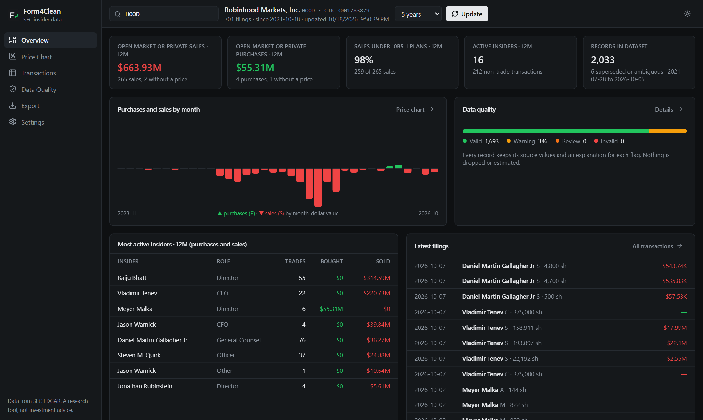
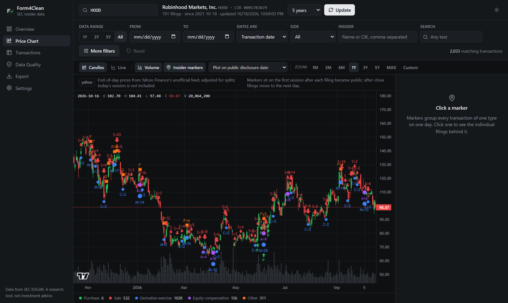
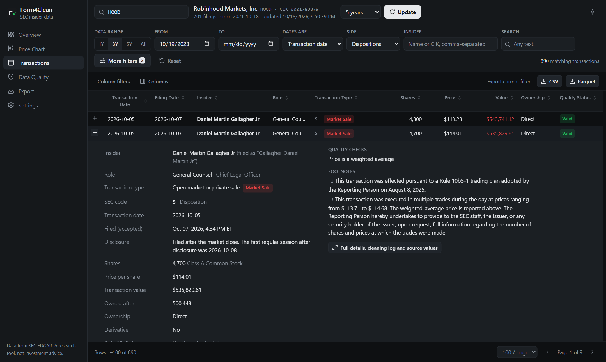
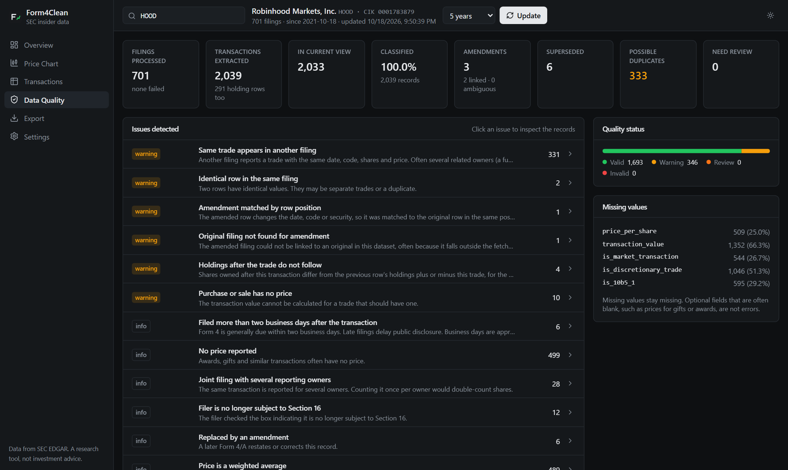

# Form4Clean

**Clean, standardized, research-ready SEC insider trading data.**

Form4Clean downloads Form 4 insider filings directly from SEC EDGAR, cleans and classifies
every transaction, reconciles amendments, and flags anything that needs a second look. You get
the result as a Python library, a command-line tool, exports (CSV, Parquet, JSON) and a local
dashboard. It runs entirely on your computer: no account, no API key, no cloud, no cost.

[](https://github.com/wavebyrd/form4clean/actions/workflows/ci.yml)
[](LICENSE)




## Why raw insider data needs cleaning

Form 4 filings are public, but they are not research-ready:

- **Codes are easy to misread.** A `P` or `S` is an "open market **or private**" trade, not
  necessarily an exchange trade. Awards, option exercises and tax withholding are not trading
  decisions, but they sit in the same tables.
- **The important facts hide in footnotes**, such as whether a sale was under a Rule 10b5-1
  plan or that a price is a weighted average of many lots.
- **Amendments do not say what they amend.** Count the original and the Form 4/A and you
  double-count the trade; replace the whole original and you can lose rows the amendment never
  touched.
- **Joint filings repeat one trade for several owners.** A fund and its general partner can
  also file the same trade separately.
- **Timing is subtle.** Most filings arrive after the close, so the trade was not public until
  the next session. The SEC's own submissions index lists acceptance times in the wrong time
  zone ([details](docs/sec-data.md#acceptance-timestamps)).
- **Formatting varies.** `Common`, `COMMON STOCK, PAR VALUE $0.001 PER SHARE`, `RSU`; names
  filed as `LAST FIRST MIDDLE`; numbers with commas; dates with XML timezone suffixes.

## What Form4Clean does

- **Official data only.** It uses public SEC EDGAR endpoints, one request per filing, with
  rate limiting, retries with backoff and a permanent cache. It never scrapes third-party sites.
- **Never drops, never invents.** Every source row becomes a record. Values that cannot be read
  become null with an explanation; nothing is estimated. Each record keeps its original strings,
  accession number and SEC link, and every change is logged.
- **Classifies every Form 4 code** into standard categories, with three-state (`true`, `false`,
  unknown) open-market, discretionary and Rule 10b5-1 fields and a written reason.
- **Reconciles amendments conservatively**, giving a current view and a point-in-time view
  with no look-ahead bias.
- **Checks data quality.** 39 documented checks give each record a status (`VALID`, `WARNING`,
  `REVIEW_REQUIRED`, `INVALID`) with plain-language explanations, plus an aggregate report.
- **Exact numbers.** Amounts are decimals end to end. Exports are reproducible byte for byte and
  ship with a manifest of versions and SHA-256 checksums.

## Quick start

You need Python 3.12+ and [uv](https://docs.astral.sh/uv/) (or pip).

```bash
git clone https://github.com/wavebyrd/form4clean
cd form4clean
uv venv && uv pip install -e .            # or: python -m venv .venv && pip install -e .

# The SEC asks automated tools to identify themselves. Your email is only sent to sec.gov.
form4clean config --email "you@example.com"

form4clean fetch NVDA --years 5           # download and clean (about a minute)
form4clean dashboard                      # opens http://127.0.0.1:8765
```

In the dashboard, type any ticker and choose **Download from SEC**. Then browse the overview,
filter transactions, plot them on the price chart, review data quality and export.

## Command line

```bash
form4clean fetch NVDA --years 5                 # or --start 2020-01-01 --end 2024-12-31
form4clean clean NVDA                           # re-run the cleaning rules (no network)
form4clean transactions NVDA --role CEO --code S --min-value 1000000
form4clean quality NVDA                         # data quality report (--json for the full report)
form4clean export NVDA --format parquet         # cleaned + raw data, quality report, manifest
form4clean export NVDA --format csv --as-of 2025-06-01    # what was public on that date
form4clean dashboard
form4clean --help
```

`export` writes to `form4clean_exports/NVDA/`:

| File | Contents |
|---|---|
| `nvda_transactions.parquet` | Cleaned records (current view, filters applied) |
| `nvda_raw_transactions.parquet` | Every parsed row exactly as filed |
| `nvda_quality_report.json` | Counts, missing values, amendment outcomes, every issue |
| `nvda_manifest.json` | Schema and cleaning versions, generation time, source, date range, amendment policy, filters, record count, quality summary, file checksums |

## Python API

```python
from form4clean import InsiderData

data = InsiderData("NVDA")  # downloads on first use, then reads the local copy

transactions = data.transactions(
    start="2024-01-01",
    end="2026-01-01",
    clean=True,
    reconcile_amendments=True,
)

df = transactions.to_pandas()  # Decimal values stay exact; .to_polars() also works
transactions.to_parquet("nvda_insiders.parquet")  # plus nvda_insiders.manifest.json

big_sales = data.transactions(
    transaction_types=["Market Sale"],  # categories, see below
    roles=["CEO", "CFO"],
    min_value=1_000_000,
    quality=["VALID", "WARNING"],  # leave out records that need review
)

past = data.transactions(as_of="2025-06-01")  # point in time, no look-ahead
everything = data.transactions(include_superseded=True)
raw = data.transactions(clean=False)  # parsed source rows
report = transactions.quality_report
```

Other filters: `codes`, `insiders` (names or CIKs), `direction`, `max_value` and `date_field`
(`"transaction"`, `"disclosure"` or `"filing"`). See [examples/](examples/).

## How transactions are classified

| Category | SEC codes | Notes |
|---|---|---|
| Market Purchase | P | Open market **or private**; `is_market_transaction` is unknown unless a footnote says |
| Market Sale | S | Same |
| Equity Compensation | A | Grants and awards; not discretionary |
| Derivative Exercise | M, X, O | Option exercises and RSU conversions; not market trades |
| Conversion | C | |
| Tax-Related | F | Shares withheld for tax or exercise price; not discretionary |
| Gift or Transfer | G, W | |
| Other | D, I, E, H, L, Z, J, K, U, V | |
| Unknown | anything else | Never guessed; flagged for review |

Every record also has `transaction_code` (as filed), `transaction_type`,
`transaction_direction`, `is_derivative`, `is_market_transaction`, `is_discretionary_trade`,
`is_10b5_1`, `classification_confidence` and `classification_reason`. Full rules:
[docs/cleaning-rules.md](docs/cleaning-rules.md).

## How amendments are handled

A Form 4/A is linked to its original only when exactly one earlier Form 4 from the same
reporting owner matches its date of original submission. Rows are then matched one by one.
Matched originals become `SUPERSEDED` and leave the current view, and the amended rows become
`AMENDED_CORRECTED` or `AMENDED_RESTATED`. Anything that cannot be matched confidently is kept,
flagged for review and kept out of the current view, so nothing is double-counted or silently
replaced. Nothing is deleted.

The **point-in-time view** (`--as-of`, `as_of=`) rebuilds the dataset from only the filings
accepted by the cutoff, reconciled with only the amendments accepted by then. Details:
[docs/amendments.md](docs/amendments.md).

## Dashboard





- **Overview**: 12-month purchases and sales, the share of sales under 10b5-1 plans, the
  most active insiders and the latest filings.
- **Price chart**: candlestick or line, volume, zoom presets and a custom range. Insider
  markers are colored by type and placed by default on the **first session after public
  disclosure**, so a trade never shows up before investors could know about it. Click a marker
  to see the filings behind it.
- **Transactions**: sorting, column filters, column chooser, resizable columns, expandable
  rows, SEC links, and CSV or Parquet export of exactly what is filtered.
- **Data quality**: every issue with what it means, why it matters, what the engine did and
  whether to review it, with the affected records one click away.
- **Export** and **Settings**.

The chart, table and exports share one server-side filter, so they always agree.



**Price data.** The SEC does not publish stock prices, so the chart needs a source: the
optional Yahoo Finance provider (`pip install "form4clean[yfinance]"`) or a CSV of daily prices
you download yourself. Yahoo needs no key but uses an unofficial feed that can break, so it is
never installed or chosen automatically. The
chart only draws once one is configured in Settings, and Form4Clean never shows placeholder
prices. Everything else works without prices. See [docs/dashboard.md](docs/dashboard.md).

## Documentation

| | |
|---|---|
| [docs/schema.md](docs/schema.md) | Every column, its type and meaning (generated from the code) |
| [docs/cleaning-rules.md](docs/cleaning-rules.md) | Normalization, classification and cross-record checks |
| [docs/quality-flags.md](docs/quality-flags.md) | Every quality flag and transaction code |
| [docs/amendments.md](docs/amendments.md) | Amendment reconciliation and point-in-time views |
| [docs/sec-data.md](docs/sec-data.md) | Endpoints, fair-access policy, the acceptance-time issue |
| [docs/architecture.md](docs/architecture.md) | How the pieces fit |
| [docs/dashboard.md](docs/dashboard.md) | Dashboard, chart markers, price providers, frontend development |

## Known limits

- **Forms 4 and 4/A only.** The parser already reads the shared ownership XML schema; Forms 3
  and 5 need classification rules for their holdings-only tables.
- **Filings from before mid-2003** were not filed as XML and are reported as parse failures.
- **Name reordering is a heuristic.** Two-word surnames without a particle (`NORA JOHNSON
  SUZANNE M`) come out wrong. `insider_name_raw` always has the filed name, and `insider_cik` is
  the reliable key.
- **Duplicate detection across filings flags; it does not merge.** You decide whether related
  owners' filings describe one trade.
- **Business days for late filings** are approximated with the NYSE calendar, not the SEC's.
- **The dashboard is single-user and local.** It has no authentication; keep it on 127.0.0.1.

## Contributing

Issues and pull requests are welcome, especially data issues with an accession number. Start
with [CONTRIBUTING.md](CONTRIBUTING.md). The rule that matters most: never drop a source record
and never invent a value.

## License and disclaimer

MIT. See [LICENSE](LICENSE).

Form4Clean is a research and data-processing tool. It is not investment advice, and its output
may contain errors from source filings or from the cleaning rules. Check important figures
against the original filing linked on every record. Form4Clean is not affiliated with the SEC.
Price charts use [TradingView Lightweight Charts](https://github.com/tradingview/lightweight-charts)
for drawing only.
